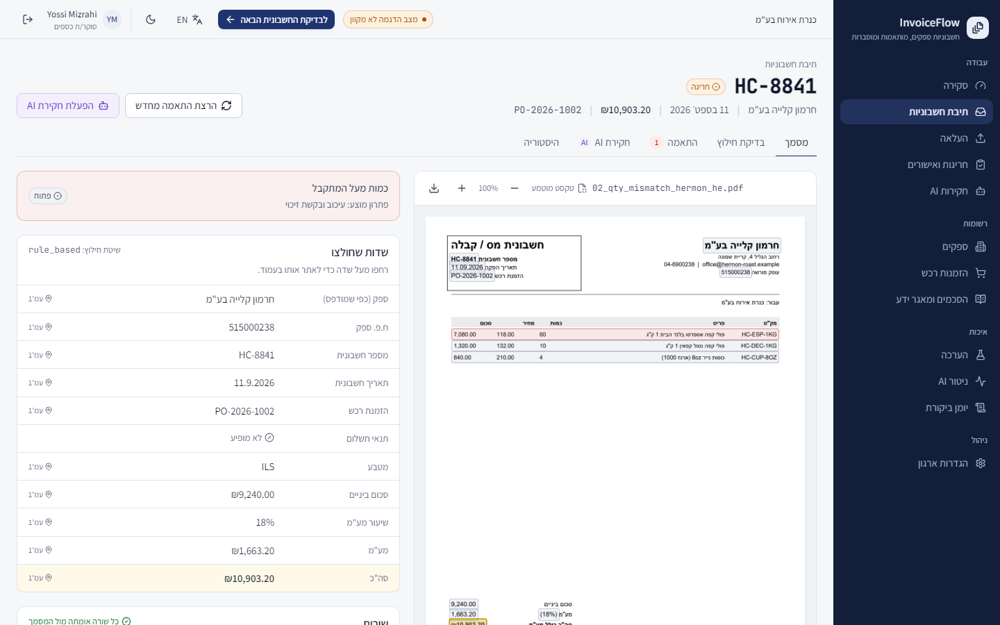
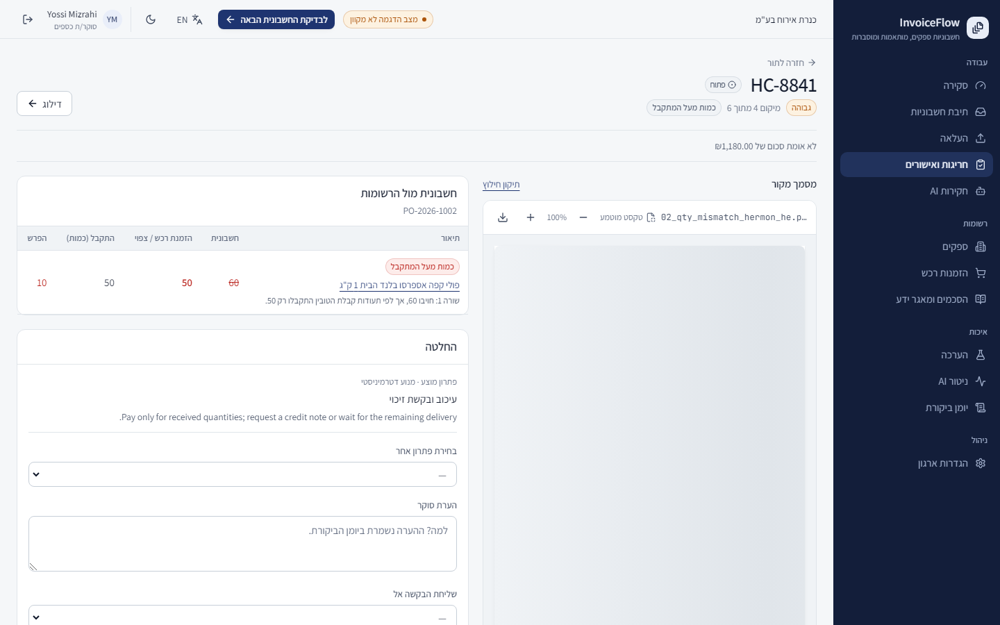
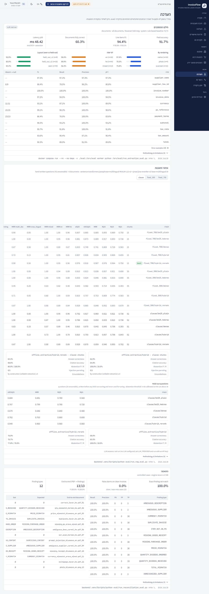

# InvoiceFlow

**AI-assisted supplier-invoice processing for Hebrew and English documents, with deterministic reconciliation, cited explanations and humans in control.**

InvoiceFlow reads supplier invoices (native PDFs, scans, phone photos; Hebrew, English or mixed). It extracts and **verifies** every field against the document, then runs **two-way and three-way matching** against purchase orders and goods receipts in a deterministic `Decimal` engine. When something is wrong, a **LangGraph agent** investigates. It retrieves the relevant clauses from supplier agreements and purchasing policies (Hebrew-first hybrid RAG with reranking) and drafts an **evidence-backed, cited** summary. Then it stops and waits for a person: a reviewer decides, and every step lands in a **hash-chained audit trail**. No model can approve or pay anything.



| | |
|---|---|
|  |  |
|  |  |

## What it demonstrates
- **Document intelligence for Hebrew:**
  - native text layer first, Tesseract `heb+eng` OCR fallback with Otsu preprocessing;
  - **visual-to-logical bidi reconstruction**: column segmentation, per-segment direction inference, UBA, bracket un-mirroring;
  - word-level bounding boxes, so every field is highlighted on the page.
- **Validated structured extraction:**
  - LLM extraction through a forced tool call or a JSON schema, validated with Pydantic, plus a transparent rule-based offline baseline;
  - values must appear **verbatim** in the document or they are discarded; missing fields are explicit nulls;
  - arithmetic checks in `Decimal` against the printed tax rate (no hard-coded VAT).
- **Deterministic reconciliation:** 22 finding types (price, quantity vs ordered or received, duplicates, missing PO or GR, ambiguous supplier or description, currency, totals, suspicious content), configurable tolerances, a full audit trace, and amount-at-risk per finding.
- **Hebrew-first RAG:**
  - prefix-aware Hebrew normalization, clause chunking, BM25, multilingual dense retrieval, RRF and a cross-encoder reranker;
  - verified citations that open the source PDF at the highlighted passage;
  - abstention when evidence is missing; injected passages are screened out;
  - **benchmarked rather than assumed** (dense retrieval loses to BM25 on Hebrew here, see below).
- **Agent with guard-rails:** LangGraph with typed, RBAC-checked tools; tenant and supplier scope enforced by code; PostgreSQL checkpoints with crash recovery; a human-approval interrupt; no payment tools.
- **Multi-tenant SaaS foundations:**
  - RBAC (4 roles), tenant isolation in the app **and** in PostgreSQL row-level security;
  - revocable server-side sessions: 15-minute access tokens, rotating refresh tokens with reuse detection, single-use SSE tickets;
  - segregated two-step approvals;
  - append-only, hash-chained audit log;
  - durable job queue with retries, idempotency and stale-lock recovery;
  - live progress over SSE; rate limits; upload hardening.
- **Evaluation and observability:** separate benchmarks for extraction, RAG and reconciliation, with an in-app dashboard; telemetry for every model call (latency, tokens, cost when priced, errors, tool calls).
- **Product-grade UI:** Next.js 15, Tailwind, Radix/shadcn-style components, Recharts; **Hebrew RTL by default** with English; light and dark themes; 13+ pages.

## Quick start
Requirements: Docker Desktop (about 6 GB of free disk for images and models). Ports used: 3000 (web), 8010 (API), 5433, 6380, 8333.

```bash
git clone <this repo> invoiceflow && cd invoiceflow
docker compose up -d --build                         # postgres, redis, s3, api (runs migrations), worker, web
docker compose exec api python -m app.cli seed --reset   # fictional demo org + documents, processed end-to-end
```
Then open http://localhost:3000.

On the first run the worker downloads the local embedding model (220 MB). The first knowledge-base question with the reranker enabled downloads another 1.1 GB; set `RERANKER_BACKEND=none` to skip it.

**Demo accounts** (fictional organization "כנרת אירוח"). These are demo-only credentials, shared by all accounts: password `InvoiceFlow!2026`.
| Email | Role |
|---|---|
| `finance@kinneret.example` | Finance reviewer (decides exceptions, first approval) |
| `procurement@kinneret.example` | Procurement manager (uploads, master data) |
| `admin@kinneret.example` | Administrator (settings, second approval) |
| `viewer@kinneret.example` | Read-only |
| `admin@yarden.example` | Admin of a *second* tenant (to show isolation) |

**Try it:**
1. Go to Upload, then "Try a sample", then `upload_hermon_price_mismatch_he` (a Hebrew PDF).
2. Watch the live pipeline.
3. Open the invoice and check the Reconciliation tab (price +5.1%).
4. Open the AI-investigation tab (cited clauses) and the exception.
5. Approve the proposal with a note, then look at the History and Audit pages.

The 13 seeded invoices cover each scenario: correct, quantity mismatch, price mismatch, duplicate, missing PO, ambiguous description, OCR scan, prompt injection, ambiguous supplier, missing GR, currency mismatch, multi-page, photo.

### AI modes
- **Offline (default):** no external calls and no cost. Extraction uses the rule-based baseline; explanations come from templates; answers are extractive. Everything is labelled *Offline demo mode* in the UI. Nothing pre-recorded is presented as live inference.
- **LLM:** set `LLM_PROVIDER=anthropic` and `ANTHROPIC_API_KEY`, or `LLM_PROVIDER=openai` with `OPENAI_API_KEY` or `OPENAI_BASE_URL` (Ollama/vLLM work). Then restart `api` and `worker`. See `.env.example`.

## Measured results
These come from the scripts in `/eval`; the JSON is in `eval/results/` and is rendered on the Evaluation page.

| Component | Headline (honest scope) |
|---|---|
| Extraction, rule-based baseline, 73 synthetic docs | Field accuracy **0.917**: native 0.976, scanned 0.758, photo 0.705. **Held-out layouts (v2, scored once before and once after the layout-tolerant parser): 0.278 → 0.830.** Line-item F1 0.944. Absent fields returned as null in 57/57 cases. |
| Retrieval, 50 hand-written questions (he/en/mixed/multi-doc/conflicting/unanswerable) | Clause + hybrid + rerank: **R@5 0.940, nDCG@5 0.870, MRR 0.859**. Dense MiniLM alone: MRR 0.642. BM25: MRR 0.860. Reranking costs about 1 s/query on CPU. On 35 **held-out** questions: R@5 0.980, MRR 0.960. |
| Grounded answers (offline extractive) | Correctness 0.643, citation accuracy 0.686, abstention P / R 0.80 / 1.00 (threshold calibrated on this set), injection parroting 0/1. **Held out:** correctness 0.760, abstention P / R 0.78 / 0.70. |
| Reconciliation, 348 controlled cases | P = R = 1.00 on all 12 types; **0 false alarms** on 123 clean or near-miss invoices |
| End to end (PDF → OCR/extraction → engine), 13 demo docs | 13/13 scenarios exact, P = R = 1.00 (was 12/13 because of a PO-label extraction bug, now fixed). |

LLM extraction and answering are **not** benchmarked here, because that needs a paid API. `run_extraction_eval.py --llm` measures it once you configure a provider. Full methodology and limitations: [docs/EVALUATION_PLAN.md](docs/EVALUATION_PLAN.md).

## Tests
```bash
cd backend && python -m pytest -q          # unit + PostgreSQL/RLS integration (needs the compose postgres + redis)
cd frontend && npm test && npm run typecheck && npm run lint   # Vitest
cd frontend && npx playwright test          # workflows + 276 responsive/theme/language screen checks
```
CI (`.github/workflows/ci.yml`) runs the backend tests against pgvector and Redis services, the frontend checks and build, then Docker Compose and Playwright.

The risk-first workspace continuation and latest offline verification are recorded in [docs/REVIEW_WORKSPACE_CONTINUATION.md](docs/REVIEW_WORKSPACE_CONTINUATION.md). Run browser tests against disposable seeded data: they record human decisions. Set `SCREENSHOTS=1` to include both screenshot suites.

**Reproduce the benchmarks:** `make eval`. On Windows, run the four commands from the Makefile.

## Repository layout
```
backend/   FastAPI app (app/), Alembic migrations, tests, Dockerfile
  app/services/{documents,extraction,reconciliation,rag,agent,llm}  ← the core
  app/demo/  synthetic business spec, PDF renderer, knowledge texts, seed
frontend/  Next.js app (src/app/(app)/…), components, i18n (he/en), tests (unit + e2e)
eval/      datasets, benchmark scripts, results/*.json
data/demo/ generated synthetic invoices, upload samples, agreements/policies, manifest.json
docs/      PRD, architecture, database, API, pipeline, RAG, agent, security, evaluation, plan, demo script
infra/     postgres init (roles), SeaweedFS S3 config
```

## Documentation
[PRD](docs/PRD.md) · [Architecture](docs/ARCHITECTURE.md) · [Database](docs/DATABASE_DESIGN.md) · [API](docs/API_DESIGN.md) · [Document pipeline](docs/DOCUMENT_PIPELINE.md) · [RAG](docs/RAG_DESIGN.md) · [Agent](docs/AGENT_DESIGN.md) · [Security](docs/SECURITY_MODEL.md) · [Evaluation](docs/EVALUATION_PLAN.md) · [Implementation plan](docs/IMPLEMENTATION_PLAN.md) · [Deployment](docs/DEPLOYMENT.md) · [Demo script](docs/DEMO_SCRIPT.md) · [CV bullets](docs/CV_BULLETS.md)

## Data provenance
All companies, people, tax IDs, e-mail domains (`.example`, reserved by RFC 2606), documents and amounts are **synthetic**. They were generated by `backend/app/demo/` (spec, renderer, knowledge texts) and reproduced with `python -m app.cli generate-docs`. Any resemblance to real entities is coincidental. No real financial records are included. VAT rates appear only as values printed on synthetic documents.

## Tech stack
- **Backend:** Python 3.12, FastAPI, Pydantic v2, SQLAlchemy 2, Alembic
- **Data:** PostgreSQL 16 + pgvector (RLS), Redis, S3 (SeaweedFS locally)
- **Documents:** pdfplumber/pypdfium2, Tesseract, python-bidi
- **AI:** LangGraph (+ Postgres checkpointer), Anthropic / OpenAI-compatible SDKs, fastembed (ONNX MiniLM + jina reranker)
- **Frontend:** Next.js 15, React 19, TypeScript, Tailwind, Radix, Recharts, SWR
- **Testing and delivery:** Pytest, Vitest, Playwright, Docker Compose, GitHub Actions
