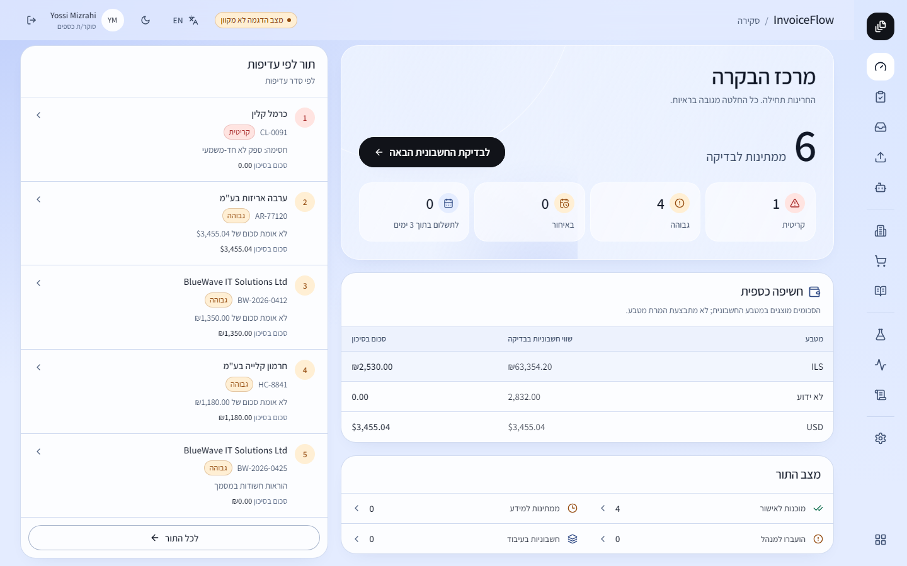
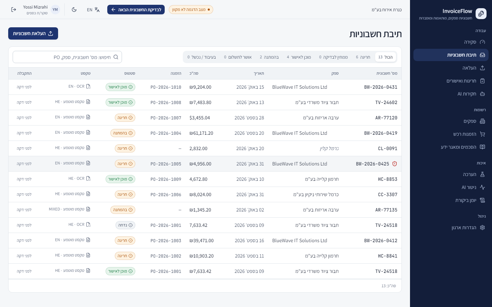
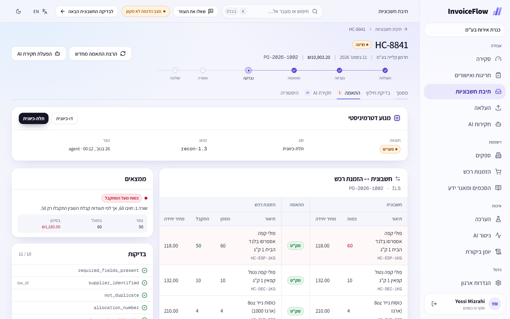
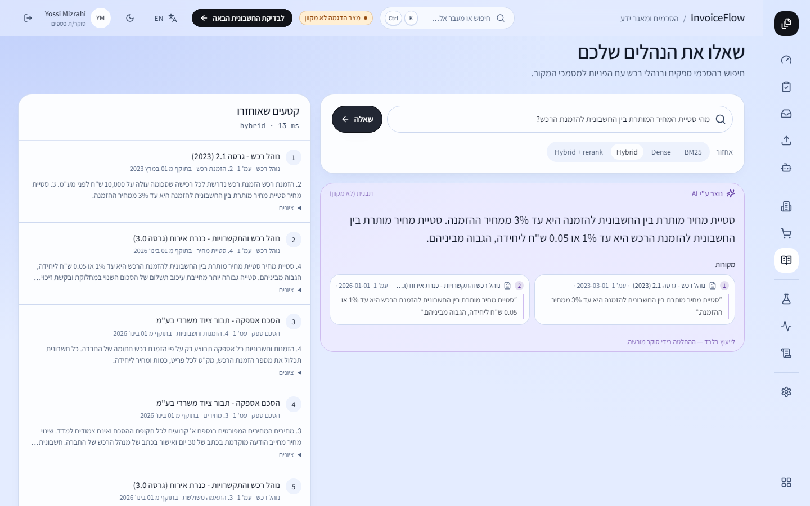
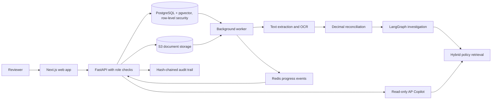

# InvoiceFlow

**Accounts-payable automation for Hebrew and English supplier invoices.**

[](https://github.com/EliyahuEden/InvoiceFlow-AI-Powered-Financial-Document-Processing/actions/workflows/ci.yml)


InvoiceFlow reads supplier invoices in any format (native PDFs, scans, phone photos; Hebrew, English or mixed),
verifies every field against the page, and matches each invoice to its purchase order and goods receipt with a
deterministic engine. When something doesn't match, an AI investigation explains why, citing the exact clause in the
supplier agreement or purchasing policy, and a reviewer decides. Every step is recorded in a tamper-evident audit trail.
No model can approve or pay an invoice.

**Hosted demo:** <https://invoiceflow-demo.duckdns.org>. Choose **Enter the demo** for a private workspace with a
fictional company's invoices, deleted after 24 hours.



## What it does

**Capture.** Upload invoices one by one or in bulk. InvoiceFlow reads the text layer first and falls back to Hebrew and
English OCR, reconstructs right-to-left text correctly, and extracts supplier, dates, totals, VAT, PO reference, the
Israeli tax-invoice allocation number and every line. Each value is traced to where it appears on the page; a value
that cannot be found in the document is discarded, never guessed.

**Match.** Two- and three-way matching against purchase orders and goods receipts in exact decimal arithmetic, with
configurable tolerances. 22 finding types cover prices, quantities ordered and received, duplicates, missing orders or
receipts, ambiguous suppliers or lines, currency, totals and suspicious embedded instructions. Each finding states the
money at risk.

**Investigate.** For every exception, an AI investigation gathers the invoice, order, receipts and the relevant clauses
from your agreements and policies, then writes a summary with numbered citations that open the source document at the
quoted passage. The output is labelled as advice; the suggested next step comes from the matching rules.

**Decide and approve.** A priority queue ranks open cases by money at risk and due date and explains why each case is
first. Reviewers approve, reject, escalate or request information, with segregated two-step payment approval, dual
approval above a threshold, and an automatic payment hold after a supplier's bank details change.

**Ask.** Ask questions about your agreements and policies in Hebrew or English and get answers grounded in the
retrieved passages, or no answer when the evidence isn't there. A read-only AP Copilot answers questions about your
own invoices, cases and suppliers.

**Govern.** Four roles with per-endpoint permissions, tenant isolation enforced by PostgreSQL row-level security,
optional organization-wide two-factor sign-in, an append-only hash-chained audit trail with one-click verification,
telemetry for every model call, and measured quality for extraction, retrieval and matching.

| | |
|---|---|
|  |  |
|  |  |

The interface is Hebrew right-to-left by default, with English, in light and dark themes, from phone to desktop, and
meets WCAG 2.2 AA in automated checks.

## How it works



An upload and its processing job are committed together. Workers claim jobs with leases and a bounded retry budget,
extract and verify the fields, run reconciliation and open exceptions. The investigation agent and the Copilot reach
data only through role-checked tools scoped to the organization, and the agent pauses for a human decision. See
[Architecture](docs/architecture.md).

## Getting started

Requires Docker with enough disk space for the images and the model cache.

```bash
git clone https://github.com/EliyahuEden/InvoiceFlow-AI-Powered-Financial-Document-Processing.git invoiceflow
cd invoiceflow
cp .env.example .env                                     # set JWT_SECRET; an LLM key is optional
docker compose up -d --build                             # postgres, redis, s3, api, worker, web, mailpit
docker compose exec api python -m app.cli seed --reset   # demo organization, documents processed end to end
```

Open http://localhost:3000. Emails (invitations, password resets) go to the local inbox at http://localhost:8025.
On first run the worker downloads the multilingual-e5-large embedding model (about 2.1 GB).

Demo accounts for the fictional organization "כנרת אירוח" share the password `InvoiceFlow!2026` (demo data only):

| Email | Role |
|---|---|
| `finance@kinneret.example` | Finance reviewer: decides exceptions, first approval |
| `procurement@kinneret.example` | Procurement manager: uploads invoices, maintains suppliers and orders |
| `admin@kinneret.example` | Administrator: settings, team, second approval |
| `viewer@kinneret.example` | Read-only |
| `admin@yarden.example` | Administrator of a second organization, to see tenant isolation |

The 13 seeded invoices each cover one scenario: a clean match, quantity and price mismatches, a duplicate, a missing
order, an ambiguous line, an OCR scan, an embedded prompt-injection attempt, an ambiguous supplier, a missing receipt,
a currency mismatch, a multi-page invoice and a phone photo.

## Configuration

All settings are environment variables; [`.env.example`](.env.example) documents each one.

| Area | Settings |
|---|---|
| AI provider | `LLM_PROVIDER` = `openai` (any OpenAI-compatible endpoint: OpenAI, Groq, a local Ollama or vLLM), `anthropic`, or `offline`. Without a key InvoiceFlow runs fully offline: rule-based extraction, template explanations and extractive answers, clearly labelled. |
| AI spending | `AI_DAILY_TOKEN_BUDGET` per organization per day, `RATE_LIMIT_AI_PER_MINUTE` per user. Past the budget the organization continues in offline mode until the next day. |
| Email | `SMTP_*`, `EMAIL_FROM`, `APP_BASE_URL`; any SMTP provider. |
| Storage | `S3_*`; any S3-compatible service. |
| Sign-up and sessions | Public sign-up and session lifetimes; organizations can also require two-factor sign-in in the app. |

## Quality

Benchmarks run from [`eval/`](eval) on synthetic, labelled datasets; results are in `eval/results/` and shown on the
in-app Evaluation page.

| Component | Result |
|---|---|
| Field extraction, 73 documents | **92.0%** field accuracy with rules alone; **92.5%** rules-first with a model, which was called on 12 of 73 documents |
| Policy retrieval, 35 held-out questions | **1.00** recall@5 and **0.950** MRR with hybrid search and reranking |
| Policy answers, 35 held-out questions | **32/35** passed; all 10 unanswerable questions correctly refused; **92.6%** citation accuracy |
| Reconciliation, 468 controlled cases | Precision and recall **1.00** on every finding type; **0** false alarms on 204 clean or near-miss invoices |
| End to end, 13 demo documents | **13/13** scenarios produce exactly the expected findings |

Datasets, metrics, scoring rules and limitations: [Evaluation](docs/evaluation.md). Reproduce with `make eval`.

## Testing

```bash
cd backend && python -m pytest -q                               # 700+ unit and PostgreSQL integration tests
cd frontend && npm run typecheck && npm run lint && npm test    # TypeScript, ESLint, Vitest
cd frontend && npx playwright test                              # workflows, accounts, accessibility, responsive checks
```

CI runs the backend tests against PostgreSQL with pgvector and Redis, the frontend checks and build, then the stack in
Docker Compose with the browser tests. Browser tests change data, so run them against the disposable stack described
in `docker-compose.e2e.yml`.

## Deployment

`docker-compose.prod.yml` adds Caddy with automatic HTTPS (only ports 80 and 443 are published), nightly database
backups copied to object storage with a monthly restore drill, and health and alert endpoints for monitoring. See
[Deployment](docs/deployment.md).

## Project structure

```
backend/    FastAPI API and background worker, Alembic migrations, tests       → backend/README.md
frontend/   Next.js web app, Hebrew and English, unit and browser tests       → frontend/README.md
eval/       benchmark datasets, scripts and results
data/demo/  synthetic demo documents: invoices, upload samples, agreements and policies
docs/       architecture, pipeline, retrieval, agent, security, evaluation, deployment → docs/README.md
infra/      PostgreSQL roles, Caddy, backups, local S3
```

## Security

Report vulnerabilities privately as described in [SECURITY.md](SECURITY.md). The threat model and controls are in
[docs/security.md](docs/security.md).

## Demo data

All companies, people, tax IDs, email domains (`.example`), documents and amounts in this repository are synthetic,
generated by `backend/app/demo/`. No real financial records are included.

## License

Proprietary. Copyright (c) 2026 InvoiceFlow. All rights reserved. See [LICENSE](LICENSE).
