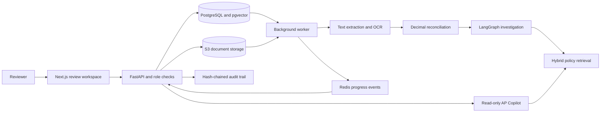

# InvoiceFlow

**AI-assisted supplier-invoice processing for Hebrew and English documents, with deterministic reconciliation, cited explanations and humans in control.**

InvoiceFlow reads supplier invoices (native PDFs, scans, phone photos; Hebrew, English or mixed). It extracts and **verifies** every field against the document, then runs **two-way and three-way matching** against purchase orders and goods receipts in a deterministic `Decimal` engine. When something is wrong, a **LangGraph agent** investigates. It retrieves the relevant clauses from supplier agreements and purchasing policies (Hebrew-first hybrid RAG with reranking) and drafts an **evidence-backed, cited** summary. Then it stops and waits for a person: a reviewer decides, and every step lands in a **hash-chained audit trail**. No model can approve or pay anything.

## Demo

1. Sign in to the quick-start stack as `finance@kinneret.example`. On **Upload**, choose `upload_tavor_correct_he` and open **Reconciliation** to see the clean three-way match.
2. Upload `upload_hermon_price_mismatch_he`. Open **Reconciliation** to compare the invoiced unit price of ₪124 with the PO price of ₪118.
3. In **AI investigation**, open a citation to see the relevant clause in the source PDF. Open the exception, write a reviewer note and approve the proposed resolution.
4. In **Audit trail**, find the decision and select **Verify chain**. Use **Ask Copilot** to ask which cases need attention or how much is at risk by currency.

[Recorded walkthrough](docs/demo/invoiceflow-walkthrough.webm) · [Interview demo script](docs/DEMO_SCRIPT.md) · [AP Copilot capabilities](docs/COPILOT.md)


| | |
|---|---|
|  |  |
|  |  |

## What it demonstrates
- **Document intelligence for Hebrew:**
  - native text layer first, Tesseract `heb+eng` OCR fallback with Otsu preprocessing;
  - **visual-to-logical bidi reconstruction**: column segmentation, per-segment direction inference, UBA, bracket un-mirroring;
  - word-level bounding boxes, so every field is highlighted on the page.
- **Validated structured extraction:**
  - LLM extraction through a forced tool call or a JSON schema, validated with Pydantic, plus a transparent rule-based offline baseline;
  - values must appear **verbatim** in the document or they are discarded; missing fields are explicit nulls;
  - arithmetic checks in `Decimal` against the printed tax rate (no hard-coded VAT).
- **Deterministic reconciliation:** 22 finding types (price, quantity vs ordered or received, duplicates, missing PO or GR, ambiguous supplier or description, currency, totals, suspicious content), configurable tolerances, a full audit trace, and amount-at-risk per finding.
- **Hebrew-first RAG:**
  - prefix-aware Hebrew normalization, clause chunking, BM25, multilingual dense retrieval, RRF and a cross-encoder reranker;
  - verified citations that open the source PDF at the highlighted passage;
  - abstention when evidence is missing; injected passages are screened out;
  - evaluation on calibration and held-out questions in Hebrew, English and mixed language.
- **Agent with guard-rails:** LangGraph with typed, RBAC-checked tools; tenant and supplier scope enforced by code; PostgreSQL checkpoints with crash recovery; a human-approval interrupt; no payment tools.
- **Multi-tenant SaaS foundations:**
  - RBAC (4 roles), tenant isolation in the app **and** in PostgreSQL row-level security;
  - self-service organization sign-up, team management and workspace switching, with emailed invitations and password-reset links (single use, hashed at rest, sign-out everywhere);
  - Israel's invoice allocation number (מספר הקצאה): read from the invoice and checked against the threshold on the invoice date (NIS 5,000 before VAT from June 2026), with the deductible VAT at risk ranked in the review queue;
  - revocable server-side sessions: 15-minute access tokens, rotating refresh tokens with reuse detection, single-use SSE tickets;
  - segregated two-step approvals;
  - append-only, hash-chained audit log;
  - durable job queue with retries, idempotency and stale-lock recovery;
  - live progress over SSE; rate limits; upload hardening.
- **Evaluation and observability:** separate benchmarks for extraction, RAG and reconciliation, with an in-app dashboard; telemetry for every model call (latency, tokens, cost when priced, errors, tool calls).
- **Product-grade UI:** Next.js 15, Tailwind, Radix/shadcn-style components, Recharts; **Hebrew RTL by default** with English; light and dark themes; 13+ pages.

## Architecture



Uploaded documents and their jobs are committed together. Workers claim jobs with leases and a bounded retry budget. Reconciliation produces the findings and approval route. The agent and Copilot retrieve evidence through role-checked tools, and the API records human decisions. [Architecture details](docs/ARCHITECTURE.md)

## Quick start
Run Docker Desktop with enough disk space for the images and model cache. The web app uses port 3000 and the API uses 8010. The data services use 5433, 6380 and 8333.

```bash
git clone <this repo> invoiceflow && cd invoiceflow
docker compose up -d --build                         # postgres, redis, s3, api (runs migrations), worker, web
docker compose exec api python -m app.cli seed --reset   # fictional demo org + documents, processed end-to-end
```
Then open http://localhost:3000.

For production, `docker-compose.prod.yml` puts Caddy in front (automatic HTTPS, only ports 80/443 published); see [Deployment](docs/DEPLOYMENT.md).

Emails (password resets, invitations) go to a local Mailpit inbox at http://localhost:8025, so nothing leaves your machine. For real delivery set the `SMTP_*`, `EMAIL_FROM` and `APP_BASE_URL` values in `.env` (any SMTP provider works).

On the first run the worker downloads multilingual-e5-large, a roughly 2.1 GB embedding model. The reranker downloads separately on first use. Set `RERANKER_BACKEND=none` to skip the reranker.

**Demo accounts** (fictional organization "כנרת אירוח"). These are demo-only credentials, shared by all accounts: password `InvoiceFlow!2026`.
| Email | Role |
|---|---|
| `finance@kinneret.example` | Finance reviewer (decides exceptions, first approval) |
| `procurement@kinneret.example` | Procurement manager (uploads, master data) |
| `admin@kinneret.example` | Administrator (settings, second approval) |
| `viewer@kinneret.example` | Read-only |
| `admin@yarden.example` | Admin of a *second* tenant (to show isolation) |

The 13 seeded invoices cover each scenario: correct, quantity mismatch, price mismatch, duplicate, missing PO, ambiguous description, OCR scan, prompt injection, ambiguous supplier, missing GR, currency mismatch, multi-page, photo.

### AI modes
- **Groq (default):** the app is set up for Groq's free tier with `openai/gpt-oss-120b`. Copy `.env.example` to `.env`, paste a free key from console.groq.com/keys into `OPENAI_API_KEY`, then run `docker compose up -d api worker`. The model only fills fields the rules could not read, writes answers with verified citations, and runs the AP Copilot and case investigations.
- **Offline (no key):** without a key nothing leaves your machine and nothing costs money. Extraction uses the rule-based baseline, explanations come from templates, and answers are extractive. The UI labels this *Offline demo mode*, and nothing pre-recorded is presented as live inference. Set `LLM_PROVIDER=offline` to force it even with a key.
- **Spending guards:** each business gets a daily model-token budget (`AI_DAILY_TOKEN_BUDGET`, default 100,000) and then continues in offline mode until the next UTC day. Policy answers, Copilot questions and investigations are limited per user per minute (`RATE_LIMIT_AI_PER_MINUTE`, default 20). Public sign-up is off by default when `ENVIRONMENT=production`.
- **Other providers:** `LLM_PROVIDER=anthropic` with `ANTHROPIC_API_KEY`, or `LLM_PROVIDER=openai` with `OPENAI_BASE_URL` set to `https://api.openai.com/v1` (plus `OPENAI_API_KEY`) or to a local Ollama/vLLM server (no key needed). See `.env.example`.

## Measured results
These come from the scripts in `/eval`; the JSON is in `eval/results/` and is rendered on the Evaluation page.

| Component | Headline (honest scope) |
|---|---|
| Extraction on 73 synthetic documents | **92.0%** field accuracy with rules. Rules-first with Groq GPT-OSS 120B reached **92.5%** and called the model on 12 of 73 documents. On 16 held-out layouts, accuracy was 84.7% with rules and 86.4% with rules-first. [Results](eval/results/extraction_latest.json) |
| Policy retrieval on the held-out set | Multilingual-e5-large, clause chunks, hybrid search and reranking achieved **1.00 recall@5** and **0.950 MRR** on the 25 answerable questions in the 35-question held-out set. [Results](eval/results/rag_e5_latest.json) |
| Offline extractive answers on the held-out set | **72%** answer correctness on the 25 answerable questions and **73.3%** citation accuracy. The system refused 6 of 10 unanswerable questions and 2 of 25 answerable ones. [Results](eval/results/rag_e5_latest.json) |
| Live policy answers on 35 held-out questions | **33/35 passed** with Groq GPT-OSS 120B. The model answered 23 of 25 answerable questions correctly and refused all 10 unanswerable questions. A pass requires the labelled facts and sources for an answer, or a correct refusal. Measured on prompt `rag-answer-v2`. The current prompt (`v3`) also refuses any answer whose amounts, durations or percentages are not in a cited quote. Two `v3` runs were cut short by Groq's free-tier token limit: on the 19 questions that completed, `v3` passed 16 and `v2` passed 17 of the same 19. A full `v3` run is still to do. [Results](eval/results/rag_llm_latest.json) |
| Live AP Copilot on 32 catalogue prompts | The initial Groq GPT-OSS 120B run passed **23/32 (71.9%)** against expected tools, filters and facts, on prompt `copilot-v1`. A rerun on the current prompt passed 24/32, but Groq's token limit meant only 5 of those answers were model-written; the other 27 came from the offline path. [Results](eval/results/copilot_llm_latest.json) · [rerun](eval/results/copilot_quality_latest.json) |
| Reconciliation, 468 controlled cases | P = R = 1.00 on all 13 types, including the Israeli allocation-number rule (39 cases that must be flagged, 81 that must not); **0 false alarms** on 204 clean or near-miss invoices |
| End to end (PDF → OCR/extraction → engine), 13 demo docs | 13/13 scenarios exact, P = R = 1.00 (was 12/13 because of a PO-label extraction bug, now fixed). |

The benchmark datasets are synthetic. See the dataset definitions, scoring rules and limitations in the evaluation plan. [Evaluation methodology](docs/EVALUATION_PLAN.md)

## Tests
```bash
cd backend && python -m pytest -q          # unit + PostgreSQL/RLS integration (needs the compose postgres + redis)
cd frontend && npm test && npm run typecheck && npm run lint   # Vitest
cd frontend && npx playwright test          # workflows + 276 responsive/theme/language screen checks
```
CI (`.github/workflows/ci.yml`) runs the backend tests against pgvector and Redis services, the frontend checks and build, then Docker Compose and Playwright.

The risk-first workspace continuation and latest offline verification are recorded in [docs/REVIEW_WORKSPACE_CONTINUATION.md](docs/REVIEW_WORKSPACE_CONTINUATION.md). Run browser tests against disposable seeded data: they record human decisions. Set `SCREENSHOTS=1` to include both screenshot suites.

**Reproduce the benchmarks:** `make eval`. On Windows, run the four commands from the Makefile.

## Repository layout
```
backend/   FastAPI app (app/), Alembic migrations, tests, Dockerfile
  app/services/{documents,extraction,reconciliation,rag,agent,llm}  ← the core
  app/demo/  synthetic business spec, PDF renderer, knowledge texts, seed
frontend/  Next.js app (src/app/(app)/…), components, i18n (he/en), tests (unit + e2e)
eval/      datasets, benchmark scripts, results/*.json
data/demo/ generated synthetic invoices, upload samples, agreements/policies, manifest.json
docs/      PRD, architecture, database, API, pipeline, RAG, agent, security, evaluation, plan, demo script
infra/     postgres init (roles), SeaweedFS S3 config
```

## Documentation
[PRD](docs/PRD.md) · [Architecture](docs/ARCHITECTURE.md) · [Database](docs/DATABASE_DESIGN.md) · [API](docs/API_DESIGN.md) · [Document pipeline](docs/DOCUMENT_PIPELINE.md) · [RAG](docs/RAG_DESIGN.md) · [Agent](docs/AGENT_DESIGN.md) · [Security](docs/SECURITY_MODEL.md) · [Evaluation](docs/EVALUATION_PLAN.md) · [Implementation plan](docs/IMPLEMENTATION_PLAN.md) · [Deployment](docs/DEPLOYMENT.md) · [Demo script](docs/DEMO_SCRIPT.md) · [CV bullets](docs/CV_BULLETS.md)

## Data provenance
All companies, people, tax IDs, e-mail domains (`.example`, reserved by RFC 2606), documents and amounts are **synthetic**. They were generated by `backend/app/demo/` (spec, renderer, knowledge texts) and reproduced with `python -m app.cli generate-docs`. Any resemblance to real entities is coincidental. No real financial records are included. VAT rates appear only as values printed on synthetic documents.

## Tech stack
- **Backend:** Python 3.12, FastAPI, Pydantic v2, SQLAlchemy 2, Alembic
- **Data:** PostgreSQL 16 + pgvector (RLS), Redis, S3 (SeaweedFS locally)
- **Documents:** pdfplumber/pypdfium2, Tesseract, python-bidi
- **AI:** LangGraph with a PostgreSQL checkpointer, Anthropic and OpenAI-compatible SDKs, FastEmbed with multilingual-e5-large and a Jina reranker
- **Frontend:** Next.js 15, React 19, TypeScript, Tailwind, Radix, Recharts, SWR
- **Testing and delivery:** Pytest, Vitest, Playwright, Docker Compose, GitHub Actions
