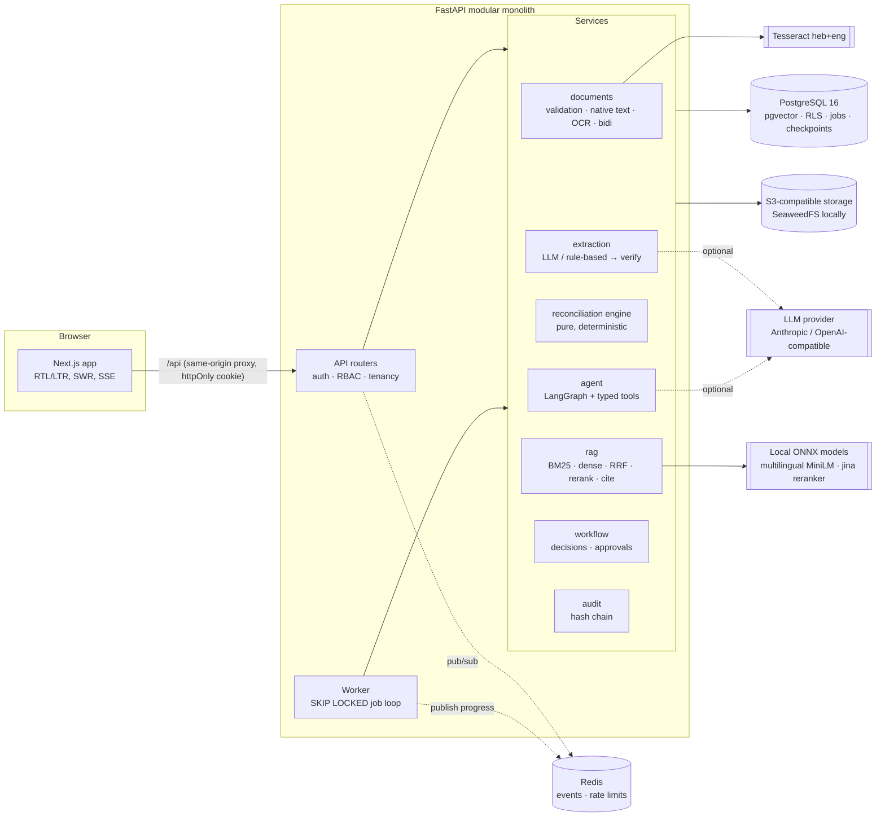

# Architecture

InvoiceFlow is a **modular monolith**: one FastAPI codebase that runs as two processes (API and worker). It uses PostgreSQL, Redis and S3-compatible storage, with a Next.js frontend. The modules have clear boundaries, so any of them can be split out later. For a single team, a monolith keeps transactions simple and lets audit writes share a commit with the change they describe.

## Request and processing flow
1. The `POST /api/invoices/upload` handler validates the file (magic bytes, size, pages, encryption, decompression bombs) and stores it under `{org}/{purpose}/{uuid}`. In **one transaction** it inserts the `documents` row, the `invoices` row, the `jobs` row (with an idempotency key) and an audit entry.
2. The worker claims the job (`FOR UPDATE SKIP LOCKED`) and opens a **tenant-bound session**. Steps:
   - extract the pages, using the native text layer or OCR per page;
   - extract the fields;
   - verify them against the document;
   - reconcile;
   - create an exception;
   - enqueue an agent investigation.
   Progress is published to Redis, and the SSE endpoint streams it to the browser.
3. The agent job runs the LangGraph workflow until the `human_review` interrupt. A human decision enqueues `agent.resume`, which continues from the PostgreSQL checkpoint.

## Module boundaries
| Module | Responsibility | Depends on |
|---|---|---|
| `core` | settings, DB sessions with tenant context, security, money, logging | – |
| `services/documents` | upload validation, page text (native / OCR), Hebrew bidi | core |
| `services/extraction` | schema, rule-based baseline, LLM extractor, verification and arithmetic checks, injection detector | documents, llm |
| `services/reconciliation` | `engine.py` (pure) and `service.py` (DB adapter, exceptions, approvals) | core |
| `services/rag` | normalization, chunking, BM25, models, retriever, answers, ingestion | documents, llm |
| `services/agent` | tools (RBAC per tool), graph, runner (checkpointer) | reconciliation, rag |
| `services/workflow` | corrections, exception decisions, payment approvals | reconciliation, audit |
| `api/routes` | HTTP surface; no business logic beyond orchestration | services |

## Key decisions and trade-offs
| Decision | Why | Trade-off |
|---|---|---|
| **PostgreSQL job queue** (not Celery or RQ) | A job commits atomically with its entity, so no orphaned uploads. Retries, backoff, idempotency keys and stale-lock recovery are easy to audit with SQL. | Throughput is lower than a dedicated broker. Fine for document workloads (seconds per job). |
| **Redis only for events and rate limits** | Best-effort. Postgres holds the truth, so a Redis outage only degrades live progress. | Two infrastructure pieces instead of one. |
| **RLS on top of app filters** | Defence in depth: a missing `WHERE organization_id` cannot leak data. The app role is neither owner nor superuser. | Every transaction must set `app.org_id`. A bug of exactly this kind was caught during development (see SECURITY_MODEL). |
| **Tesseract over PaddleOCR** | Official `heb` traineddata, a small CPU footprint, apt-installable, permissive license. PaddleOCR's Hebrew support is limited and its runtime is heavy. | Lower accuracy on noisy photos (measured: 0.545 field accuracy on photo captures, against 0.894 for native text). |
| **pdfplumber + pypdfium2** (not PyMuPDF) | MIT / Apache-licensed, with word-level geometry. PyMuPDF is AGPL. | Visual-order Hebrew needs our own bidi reconstruction (see DOCUMENT_PIPELINE). |
| **Local ONNX models (fastembed)** | Free, offline and reproducible. No GPU, no PyTorch. | MiniLM is weak on Hebrew. The benchmark shows BM25 beating dense retrieval, which is why retrieval is hybrid and reranked. |
| **LangGraph** for the agent | Durable checkpoints, native human-in-the-loop interrupts, explicit control flow with deterministic nodes. | Another framework, but a thin one (see AGENT_DESIGN). |
| **Rule-based extraction baseline** | Offline demo and a measurable baseline for the LLM. | Breaks on unseen layouts (measured: 0.341 accuracy on held-out templates). The LLM extractor exists for this. |

## Technology changes from the brief
- **MinIO → SeaweedFS** for local S3. MinIO's community Docker images are no longer publicly pullable (the pull is denied), and SeaweedFS is Apache-2.0 and S3-compatible. The app talks plain S3 through boto3, so any S3 store works in production (AWS S3, Cloudflare R2, or MinIO if licensed).
- **Background jobs on PostgreSQL** rather than a Redis broker (rationale above). Redis is still used.
- **shadcn/ui-style components** are written in-repo on Radix primitives; this is how shadcn distributes components anyway. There is no CLI step.

## Runtime topology (Docker Compose)
`postgres` (pgvector), `redis`, `s3` (SeaweedFS), `api` (runs migrations, then uvicorn), `worker`, `web` (Next.js standalone). The `models` volume caches ONNX models.
