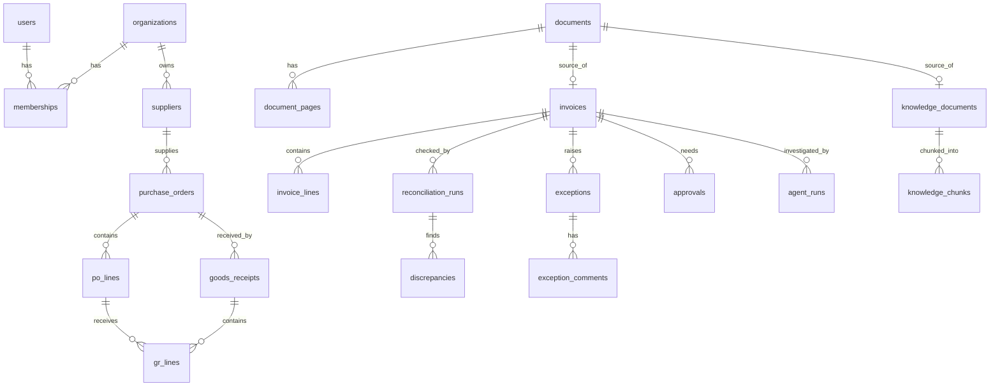

# Database design

PostgreSQL 16 with `pgvector`. The schema is managed by Alembic (`backend/alembic/versions`):
- `0001`: tables
- `0002`: security (RLS policies, grants, the append-only audit log, the HNSW index)

## Conventions
- UUID primary keys and `timestamptz` audit columns.
- **Money is `NUMERIC(18,4)`** and maps to Python `Decimal`. Quantities are `NUMERIC(18,3)`. Floats are never used for money; the API serialises amounts as strings.
- Every tenant-owned table has `organization_id`, including child tables such as `po_lines`, so a single RLS policy shape covers them all.
- Provenance is stored next to the data:
  - `invoices.field_sources`: `{field: {page, text, bbox, verified}}`
  - `invoice_lines.source`
  - `document_pages.words`: every word with a normalized bbox



## Tables
| Group | Tables | Notes |
|---|---|---|
| Tenancy | `organizations` (settings JSON: tolerances, approval threshold, locale), `users`, `memberships(role)` | Not under RLS (needed for login). Roles are re-read from the DB on every request. |
| Sessions | `auth_sessions` (user, active organization, SHA-256 of the current refresh secret, idle and absolute expiry, revocation) | Not under RLS (a user can belong to several tenants). Checked on every request through the access token's `sid`. Migration 0003. |
| Master data | `suppliers` (aliases, unique `(org, tax_id)`), `purchase_orders`, `po_lines`, `goods_receipts`, `gr_lines` | |
| Documents | `documents` (sha256, storage key, text method, language), `document_pages` (text, words+bbox, OCR confidence) | Unique `(org, sha256, purpose)` blocks duplicate files. |
| Invoices | `invoices` (status machine, raw printed supplier name and tax ID, typed fields, provenance, warnings), `invoice_lines` | |
| Reconciliation | `reconciliation_runs` (full deterministic trace, tolerances in effect, engine version), `discrepancies` (expected / actual / difference / evidence; superseded on re-run) | Runs are immutable history. |
| Workflow | `exceptions` (proposed action, AI summary JSON, decision), `exception_comments`, `approvals` (step, required role, decider) | |
| AI | `knowledge_documents`, `knowledge_chunks` (`vector(384)` + HNSW cosine index, normalized `search_text`), `agent_runs` (tool trace, result), `ai_calls` (telemetry) | |
| Ops | `jobs` (status, attempts, `run_after`, lock, progress, idempotency key) | Not under RLS: the worker claims across tenants, then binds the job's tenant. |
| Audit | `audit_logs` (actor, action, entity, before/after, meta, `prev_hash`, `hash`) | **INSERT/SELECT only** for the app role. |

## Invoice status machine
`processing → needs_review → (reconciled | exception)`
- `exception → (on_hold | rejected | reconciled | needs_review)`, via a human decision
- `reconciled → approved`: all approval steps passed
- `reconciled → rejected`
- `processing → failed`: permanent errors, such as OCR being unavailable

## Row-level security
```sql
ALTER TABLE invoices ENABLE ROW LEVEL SECURITY;
ALTER TABLE invoices FORCE ROW LEVEL SECURITY;
CREATE POLICY tenant_isolation ON invoices
  USING      (organization_id = NULLIF(current_setting('app.org_id', true), '')::uuid)
  WITH CHECK (organization_id = NULLIF(current_setting('app.org_id', true), '')::uuid);
```
- The SQLAlchemy `after_begin` hook runs `set_config('app.org_id', …, true)`, which is transaction-local, from `session.info`.
- The API's request session and every worker job session are bound to exactly one tenant.
- A session with no tenant sees **no** tenant rows.

## Roles and grants
- `invoiceflow` (owner): runs migrations; has superuser in the dev container.
- `invoiceflow_app`: used by the API and the worker. CRUD on tables, except `UPDATE`, `DELETE` and `TRUNCATE` on `audit_logs`; no access to `alembic_version`. It is not the owner, so RLS always applies.

## Indexes
- Foreign keys and `organization_id` everywhere.
- `ix_jobs_claim (status, run_after, created_at)`.
- HNSW `vector_cosine_ops` on `knowledge_chunks.embedding`.
- `invoices.invoice_number` and `status`.
